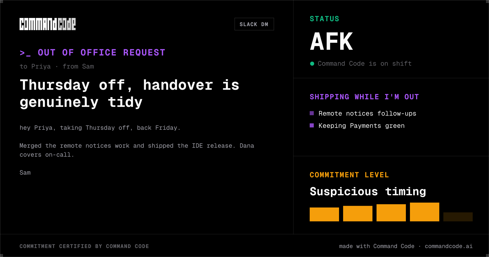

# /sickday

A skill for GTA 6 launch week (Thursday, Nov 19, 2026). It writes a believable, funny day-off
letter to your manager that cites your real recent commits and PRs and promises your coding
agent keeps shipping while you are out. It also renders each letter as a shareable card PNG.



## What it does

1. Asks for your first name, your manager's first name and, optionally,
   anything else the note should mention. Letters are emails unless you ask for Slack.
2. Writes three letter variants from your own git history and rolls a commitment level for
   each, from 1 "calendar invite" to 5 "already logged off". The level is the card's verdict.
3. Renders each as a 2400x1260 PNG card in `~/Downloads/sickday/`, printed with its full path.
4. Lets you pick one, regenerate, go hotter or milder, or edit a line.
5. Hands over the letter to copy, the card path, and a pre-filled X post link. You attach the
   card and post it yourself. Nothing is sent or posted for you.

Rendering is fully local (Node 18+, no install, no network). Emails, links and phone
numbers are stripped from cards, and cards show first names only.

## Install

Command Code:

```bash
cmd skills add vipulgupta2048/gta6-sick-day-skill --global
```

Claude Code, Codex, Cursor, Gemini CLI, GitHub Copilot, OpenCode and the other agents that
support [Agent Skills](https://agentskills.io), with the [skills CLI](https://github.com/vercel-labs/skills):

```bash
npx skills add vipulgupta2048/gta6-sick-day-skill -g
```

Or copy `skills/sickday` into your agent's skills folder by hand:

| Agent | Global | Project |
|---|---|---|
| Command Code | `~/.commandcode/skills/` | `.commandcode/skills/` |
| Claude Code | `~/.claude/skills/` | `.claude/skills/` |
| Codex, Cursor, Gemini CLI, Copilot, OpenCode, Amp | `~/.agents/skills/` | `.agents/skills/` |

Then run `/sickday`, or ask for "a sick day letter for GTA 6".

Needs Node.js 18+ and git. The GitHub CLI (`gh`) is optional: with it, letters can cite your PRs.

## Credits

- Fonts: Geist Mono, SIL Open Font License (`skills/sickday/fonts/OFL.txt`).
- Renderer: resvg-wasm, Mozilla Public License 2.0 (`skills/sickday/vendor/resvg-wasm/LICENSE`).
